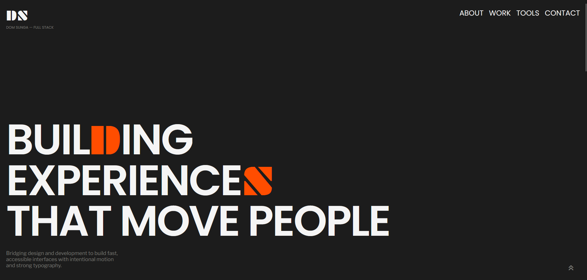

# Portfolio

A responsive, single-page developer portfolio built with vanilla HTML and CSS. No frameworks, no build tools, and no JavaScript. It presents my background, featured projects, and tech stack.

**Live site:** `https://domsunga-portfolio.onrender.com/`





## Sections

- **Hero**: bold, uppercase tagline with an orange highlight accent
- **About**: short intro on my path from research into full-stack development
- **Featured Works**: project cards with image, description, and skill tags
  - Web Crawlers (Python, Selenium, BeautifulSoup)
  - Source Monitoring System (Python)
  - Course Enrollment Simulator (JavaScript, Node.js)
  - Vanilla HTML/CSS Portfolio (HTML5, CSS3)
- **Tech Stack**: skills grouped into Frontend, Backend, and Other Tools
- **Contact**: social links with a back-to-top button

## Features

- **Responsive layout** with mobile, tablet (768px+), and desktop (1440px+) breakpoints
- **Pure CSS hamburger menu** on mobile, built with a hidden checkbox and the `:checked` selector
- **Fluid typography and spacing** using `clamp()`
- **Design tokens** in CSS custom properties (colors, fonts, padding) under `:root`
- **Glassmorphism cards** using `backdrop-filter`
- **Hover and motion effects**: lifting cards, scaling nav links and icons, blinking square accents
- **Smooth scrolling** between sections
- **Responsive grids**: the work grid goes from 1 to 2 to 4 columns, and the tools grid from 1 to 2 to 3

## Built With

- HTML5 (semantic sections, header, nav, main, footer)
- CSS3 (Flexbox, Grid, custom properties, media queries, keyframe animations)
- [Font Awesome 7.3.1](https://fontawesome.com/) for icons (via CDN)
- [Google Fonts](https://fonts.google.com/): Plaster, Poppins, Fira Sans, Libre Franklin, JetBrains Mono, Playfair Display SC

## Project Structure

```
portfolio/
├── index.html
├── index.css
├── img/            # project screenshots and tech stack icons
└── README.md
```

The `img/` folder holds the project images (for example `web-crawler-py.png`, `class-enr-sys.jpg`) and the SVG icons used in the Tech Stack section. Make sure it is committed alongside `index.html`, or the images will not load.

## Running Locally

1. Clone the repository:

   ```bash
   git clone https://github.com/drsunga/portfolio.git
   cd portfolio
   ```

2. Open `index.html` in your browser, or use the VS Code **Live Server** extension for auto-reload while editing.

An internet connection is needed to load the icons and fonts from their CDNs.

## Deployment

The site is static, so it can be hosted for free on [GitHub Pages](https://pages.github.com/):

1. Push the repository to GitHub
2. Go to **Settings → Pages**
3. Under **Build and deployment**, choose **Deploy from a branch**, select `main` and `/ (root)`, then save

## What I Practiced

- Writing semantic, accessible HTML
- Building a mobile-first layout that scales up with media queries
- Using CSS variables to keep the design consistent
- Creating interactions and animations with CSS only
- Structuring a stylesheet into clearly labeled sections

## Future Improvements

- Review alt text and add keyboard focus styles for all interactive elements
- Link each featured project card to its GitHub repository
- Add a dark/light theme toggle
- Add scroll-triggered animations
- Add React projects to the Featured Works section as I build them

## Contact

- [LinkedIn](https://www.linkedin.com/in/dom-sunga/)
- [GitHub](https://github.com/drsunga/)

## License

This project is open source and available under the [MIT License](LICENSE).
